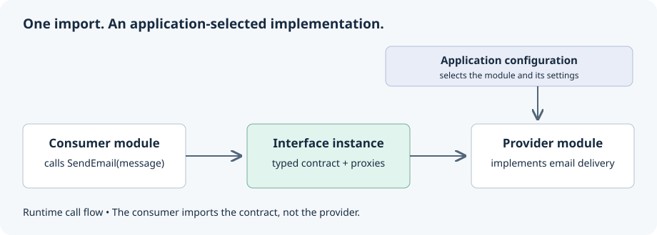
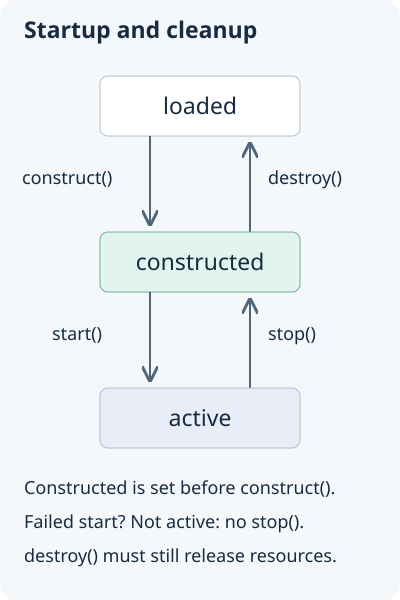

## Overview

AntelopeJS extends the ports-and-adapters model across application and ecosystem modules. Interfaces define capabilities, provider modules implement them, and the application configuration selects the modules to load. The core manages their bindings and lifecycle.

| Hexagonal concept | AntelopeJS mechanism                   | Responsibility                                             |
| ----------------- | -------------------------------------- | ---------------------------------------------------------- |
| Port              | Interface contract                     | Describe the public capability consumers need.             |
| Adapter           | Implementation in a provider module    | Translate that capability into provider-specific behavior. |
| Consumer          | Module calling an interface            | Depend on the capability rather than its implementation.   |
| Composition root  | Application configuration and assembly | Select and configure the implementations.                  |

A module is a unit of composition. It is not always an adapter. A module can contain business behavior, implement contracts, consume other contracts, or combine these roles. You still choose the boundaries that suit your application.

{width="400"}

## Interfaces are contracts between modules

An interface defines a public contract. The contract is the functions, events, and registrations that consumers and implementations agree on. An interface can also contain shared types, wrappers, and utilities that do not depend on a provider, so it is more than a TypeScript type declaration.

A standalone interface package has its own release cycle. A consumer imports that package, and a provider imports it to register an implementation. A module can also embed an interface. [Interfaces](/docs/concepts/interfaces) covers both forms.

The arrows in this diagram are dependencies on a shared contract. They are not the runtime call path.

```text
Consumer ──depends on──▶ Contract ◀──implements── Provider
```

At runtime, the consumer calls the interface API, and its proxies route each call to the registered implementation. The consumer does not import the provider package. It still depends on the API and behavior of the contract.

## The application chooses the implementation

The application selects module sources in `antelope.config.ts`. A source can be a local module, a package, or a Git repository. The `construct()` function of a provider registers its implementation with `ImplementInterface`. The consuming module does not make that choice.

An application can also assemble modules in code. In embedded mode, an existing application such as an AdonisJS server owns the process. It lists its modules in `createRuntime()` and reaches interfaces through the runtime handle. See [Embedded runtime](/docs/concepts/embedded-runtime).

The same separation holds when the provider comes from the ecosystem. You can keep a critical integration in-house, and the rest of the application consumes its contract the same way. See [Configuration](/docs/concepts/configuration) for source types and module settings.

An incoming adapter, such as an HTTP module, connects requests to application behavior. A business module can then call outgoing capabilities through contracts. Keep the dependency diagram separate from this request flow. When an incoming adapter calls a use case, the use case does not depend on that adapter.

## Modules are the building blocks

Modules declare the interfaces they provide or consume and have their own dependencies, configuration and lifecycle. Their boundaries let you develop and test them separately. They do not mean separate deployment or process isolation.

Every module follows the same lifecycle:

1. Construct. The module initializes its internal state.
2. Start. The module begins serving its interfaces.
3. Stop. The module stops serving and cleans up active work.
4. Destroy. The module releases all resources.

Each lifecycle function moves the module from one state to another:

| Function      | Transition           |
| ------------- | -------------------- |
| `construct()` | loaded → constructed |
| `start()`     | constructed → active |
| `stop()`      | active → constructed |
| `destroy()`   | constructed → loaded |

{width="400"}

## Check compatibility before you replace a provider

A consumer can keep the same import and calls when a replacement satisfies the contract version, capabilities and behavior it relies on. Selecting a different source changes the provider. It does not migrate data, and it does not prove that the two providers behave the same.

For example, the ecosystem's MongoDB and RethinkDB modules both declare the shared database interface, alongside provider-specific interfaces. A consumer using the shared API has a common boundary to evaluate. A consumer using MongoDB-specific operations has deliberately taken on a provider dependency.

Before you replace a provider, check these points:

- **Contract versions.** The replacement supports the interface versions your consumers use.
- **Capabilities and behavior.** Required operations, error handling, and side effects match what your application expects.
- **Configuration and data.** Credentials, provider settings, and any migration are ready.
- **Operational requirements.** Performance, durability, and deployment needs suit the application.
- **Tests.** Run the available contract suites and your integration tests against the replacement. Passing tests cover the behaviors they check. They do not prove that the providers are interchangeable everywhere.

AntelopeJS supplies binding and lifecycle mechanisms. It does not enforce the direction of dependencies, so a direct provider import can still bypass the contract boundary. Development HMR is also separate from a production provider migration.

## The core binds and runs modules

The core is small by design. It has three jobs:

- **Module lifecycle.** It loads, starts, stops, and destroys modules in the correct order.
- **Interface routing.** It connects each interface consumer to the module that implements it.
- **Runtime management.** It runs graceful shutdown and hot module reloading (HMR), and it propagates errors.

The core contains no business logic. It starts modules in the right order, binds each interface to its implementation, and reports failures to the caller.

## What the shared model gives you

You still have dependencies. What you gain is one integration model for all of them:

- **Consumers that do not depend on a provider.** Keep implementation-specific imports out of modules that only need the shared contract.
- **Local and ecosystem composition.** Apply the same assembly mechanisms to modules you write and modules you install.
- **Focused changes.** Change an implementation behind a compatible contract without spreading provider choices through its consumers.
- **Less runtime plumbing.** Use the interface binding and lifecycle of the core instead of building them again for each application.

## Error handling

Lifecycle callbacks can be synchronous or asynchronous. The runtime awaits them. When a required module fails to start, the launch fails and the runtime cleans up. That cleanup releases resources. It is not a transaction, and it does not reverse database writes or other external side effects.

Write `destroy()` so it can release resources after partial initialization, even if `start()` failed and `stop()` never ran. The [lifecycle failure reference](/docs/concepts/modules#startup-and-cleanup-failures) covers each callback. [Diagnostics](/docs/concepts/diagnostics) covers the events that tracing tools observe.

## See also

- [Modules](/docs/concepts/modules). Module states and lifecycle details.
- [Creating a module](/docs/module-development/creating-a-module). How to implement the lifecycle functions.
- [Embedded runtime](/docs/concepts/embedded-runtime). Run modules inside an application that owns the process.
