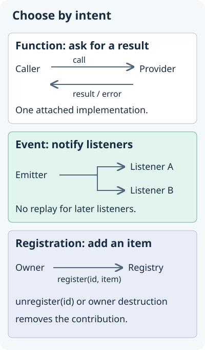

## Overview

Proxies carry all communication between AntelopeJS modules. They provide module-aware function calls, event broadcasting, and registration systems, and they clean up after a module when it unloads. A proxy backs every interface function, event, and registration in the framework.

The core tracks which module owns each proxy binding, and removes a module's bindings when that module is destroyed. This cleanup does not close sockets, cancel timers, or release database clients. The module still owns those resources.

## Choose a communication pattern

| Need | Use | Example |
| --- | --- | --- |
| Ask one provider for a result | `InterfaceFunction`, backed by `AsyncProxy` | Send an email and receive its message ID. |
| Notify listeners | `EventProxy` | Announce that a user was created. |
| Contribute an item with a lifetime | `RegisteringProxy` | Add a route and remove it when its module unloads. |

Most contract authors use `InterfaceFunction` and never construct an `AsyncProxy` themselves. Each pattern has a worked example: [function calls](#asyncproxy-example), [events](#eventproxy-example), and [registrations](#registeringproxy-example). The method tables below are for lookup. You do not need to learn them first.

{width="400"}

## `AsyncProxy`

`AsyncProxy` carries async function calls between modules. A provider attaches an implementation with `onCall`, and consumers invoke it with `call`. If a consumer calls before any implementation is attached, the call waits in a queue until one attaches. The queue holds at most 1,000 calls. Past that limit, `call` rejects with `ProviderQueueFullError`.

```typescript
import { AsyncProxy } from "@antelopejs/interface-core";

interface User {
  id: string;
  name: string;
}
declare function fetchUser(id: string): Promise<User>;

const myProxy = new AsyncProxy<(id: string) => Promise<User>>();

// Provider
myProxy.onCall(async (id: string) => {
  return await fetchUser(id);
});

// Consumer
const user = await myProxy.call("user-123");
```

### `AsyncProxy` methods

| Method                            | Description                                                                                         |
| --------------------------------- | --------------------------------------------------------------------------------------------------- |
| `onCall(callback, manualDetach?)` | Attach a callback and run the queued calls. Returns a lease for `detach`.                           |
| `call(...args)`                   | Invoke the proxied function. Returns a Promise with the result.                                     |
| `detach(lease?)`                  | Detach the callback that the lease names, or the current callback when you pass no lease.           |

::note
An `AsyncProxy` holds one callback at a time. A second `onCall` replaces the previous callback.
::

## `EventProxy`

`EventProxy` broadcasts events and knows which module registered each handler. Several handlers can register for the same event, and `emit` calls all of them. If a handler throws, the core reports the error and `emit` still calls the remaining handlers.

```typescript
import { EventProxy } from "@antelopejs/interface-core";

interface User {
  id: string;
  name: string;
}

const userCreated = new EventProxy<(user: User) => void>();

const handler = (user: User) => {
  console.log("User created:", user.name);
};
userCreated.register(handler);

userCreated.emit({ name: "Alice", id: "123" });

userCreated.unregister(handler);
```

### `EventProxy` methods

| Method                 | Description                                                                 |
| ---------------------- | --------------------------------------------------------------------------- |
| `register(callback)`   | Add an event handler. Registering the same function twice adds it once.     |
| `emit(...args)`        | Broadcast the event to all registered handlers.                             |
| `unregister(callback)` | Remove a specific handler by reference.                                     |

## `RegisteringProxy`

`RegisteringProxy` runs registration systems, where consumers add and remove items by ID. A provider sets `onRegister` and `onUnregister` callbacks to react when consumers register or unregister items. The proxy keeps every registered item. When a provider attaches, the proxy replays the stored items to it, so items registered before the provider attached still reach it.

```typescript
import { RegisteringProxy } from "@antelopejs/interface-core";

declare function handleUsers(): void;

const routes = new RegisteringProxy<
  (id: string, path: string, handler: Function) => void
>();

// Provider
routes.onRegister((id, path, handler) => {
  // Add the route to the router
});
routes.onUnregister((id) => {
  // Remove the route from the router
});

// Consumer
routes.register("route-1", "/api/users", handleUsers);
routes.unregister("route-1");
```

### `RegisteringProxy` methods

| Method                                              | Description                                                                                       |
| --------------------------------------------------- | ------------------------------------------------------------------------------------------------- |
| `onRegister(callback, manualDetach?)`               | Set the function called when an item is registered, and replay the stored items to it.           |
| `onUnregister(callback)`                            | Set the function called when an item is unregistered.                                             |
| `onHandlers(register, unregister, manualDetach?)`   | Set both callbacks under one lease, then replay the stored items.                                 |
| `register(id, ...args)`                             | Register an item with a unique ID.                                                                |
| `unregister(id)`                                    | Unregister an item by its ID.                                                                     |
| `detach(lease?)`                                    | Detach the callbacks that the lease names, or both callbacks when you pass no lease.             |

::tip
`RegisteringProxy` fits systems where items come and go while the application runs, such as route registration, middleware stacks, and template engines.
::

## Automatic cleanup

When a module is destroyed, the core cleans up every proxy:

- For each `AsyncProxy`, it detaches the callbacks that module attached.
- For each `EventProxy`, it unregisters the event handlers that module registered.
- For each `RegisteringProxy`, it removes the entries that module created.

Because of this cleanup, a module does not write teardown code for its proxy bindings. The core removes them based on which module owns them.

Bindings created while an interface instance's own files are evaluated belong to that instance, not to the first module that imported it. The same holds for the timers and promises that its top-level code starts. The core evaluates interface packages once per provider binding, not once globally, and gives each instance a context of its own. A module's destruction therefore never removes these bindings. They survive every module reload while the instance is in use, and each new generation of the providing module receives the registered entries again when it attaches. The core releases an instance and the bindings it owns when nothing reaches the instance anymore. See [Interface instances](/docs/concepts/interfaces#interface-instances).

There is one exception. A provider callback that the package attaches to its own proxies only forwards calls and registrations on a caller's behalf. That callback runs in the caller's context, and what it forwards belongs to the caller.

The core enters this context for interface packages loaded through `require()`. A package reached through an ECMAScript `import` is evaluated in its importer's context instead.

## `AsyncProxy` example

This example shows two modules that communicate through an authentication interface. The auth module, the producer, provides a `login` function. A CLI module, the consumer, calls it.

::warning
This example shows proxy wiring only. The hard-coded credentials and the placeholder token are not an authentication implementation. For signed tokens and route protection, see the [Authentication guide](/docs/guides/authentication).
::

The interface file declares the proxy and exposes a wrapper function. `InterfaceFunction` creates an `AsyncProxy` and returns a function that calls it.

```typescript [auth-module/src/interface/index.ts]
import { InterfaceFunction } from "@antelopejs/interface-core";

export interface Token {
  accessToken: string;
  expiresIn: number;
}

export namespace internal {
  export const loginProxy =
    InterfaceFunction<(username: string, password: string) => Promise<Token>>();
}

export function Login(username: string, password: string): Promise<Token> {
  return internal.loginProxy(username, password);
}
```

The producer module implements the login logic and attaches it with `ImplementInterface`.

```typescript fragment [auth-module/src/implementations/index.ts]
import type { Token } from "../interface";

export namespace internal {
  export async function loginProxy(
    username: string,
    password: string,
  ): Promise<Token> {
    if (username === "admin" && password === "secret") {
      return { accessToken: "jwt-token-here", expiresIn: 3600 };
    }
    throw new Error("Invalid credentials");
  }
}
```

```typescript fragment [auth-module/src/index.ts]
import { ImplementInterface } from "@antelopejs/interface-core";

export async function construct() {
  ImplementInterface(
    await import("./interface"),
    await import("./implementations"),
  );
}
```

The consumer module imports the wrapper function and calls it. The call waits until the auth module attaches its implementation, then resolves with the result.

```typescript fragment [cli-module/src/index.ts]
import { Login } from "@your-org/auth-module/interface";

export async function start() {
  const token = await Login("admin", "secret");
  console.log("Authenticated, token expires in", token.expiresIn, "seconds");
}
```

## `EventProxy` example

In this example, a user-management module emits an event each time it creates a user, and other modules listen for that event.

The interface file declares the `EventProxy` and exposes functions to create users and to subscribe.

```typescript [user-module/src/interface/index.ts]
import { InterfaceFunction, EventProxy } from "@antelopejs/interface-core";

export interface User {
  id: string;
  name: string;
  email: string;
}

export namespace internal {
  export const createUserProxy =
    InterfaceFunction<(name: string, email: string) => Promise<User>>();
  export const onUserCreated = new EventProxy<(user: User) => void>();
}

export function CreateUser(name: string, email: string): Promise<User> {
  return internal.createUserProxy(name, email);
}

export function OnUserCreated(handler: (user: User) => void): void {
  internal.onUserCreated.register(handler);
}
```

The producer implementation creates the user and emits the event. `ImplementInterface` does not attach anything to an `EventProxy`. The producer imports the proxy from the interface and calls `emit`.

```typescript fragment [user-module/src/implementations/index.ts]
import type { User } from "../interface";
import { internal as iface } from "../interface";

export namespace internal {
  export async function createUserProxy(
    name: string,
    email: string,
  ): Promise<User> {
    const user: User = { id: crypto.randomUUID(), name, email };
    iface.onUserCreated.emit(user);
    return user;
  }
}
```

A consumer module registers its handler during construction, so it is listening before any module runs `start()`. Several modules can register handlers on the same `EventProxy`. Events are notifications, not a durable queue. A handler does not receive events emitted before it registered.

```typescript fragment [email-module/src/index.ts]
import { OnUserCreated } from "@your-org/user-module/interface";

export function construct() {
  OnUserCreated((user) => {
    console.log("Sending welcome email to", user.email);
  });
}
```

When the email module is destroyed, the core unregisters its handler from the `EventProxy`. The module needs no cleanup code.

## `RegisteringProxy` example

In this example, an HTTP module lets other modules register API routes while the application runs. The HTTP module, the producer, manages the route table. Feature modules, the consumers, contribute routes.

The interface file declares a `RegisteringProxy` typed with an ID and the route metadata.

```typescript [http-module/src/interface/index.ts]
import { RegisteringProxy } from "@antelopejs/interface-core";

export interface RouteHandler {
  method: "GET" | "POST" | "PUT" | "DELETE";
  path: string;
  handler: (req: any, res: any) => void | Promise<void>;
}

export namespace internal {
  export const routesProxy = new RegisteringProxy<
    (id: string, route: RouteHandler) => void
  >();
}

export function RegisterRoute(id: string, route: RouteHandler): void {
  internal.routesProxy.register(id, route);
}

export function UnregisterRoute(id: string): void {
  internal.routesProxy.unregister(id);
}
```

For a `RegisteringProxy`, the implementation exports an object with a `register` function and an `unregister` function. `ImplementInterface` attaches both to the proxy, so the producer reacts when routes are added or removed.

```typescript fragment [http-module/src/implementations/index.ts]
import type { RouteHandler } from "../interface";

const routeTable = new Map<string, RouteHandler>();

export namespace internal {
  export const routesProxy = {
    register(id: string, route: RouteHandler) {
      routeTable.set(id, route);
      console.log(`Route registered: ${route.method} ${route.path}`);
    },
    unregister(id: string) {
      const route = routeTable.get(id);
      if (route) {
        routeTable.delete(id);
        console.log(`Route removed: ${route.method} ${route.path}`);
      }
    },
  };
}
```

```typescript fragment [http-module/src/index.ts]
import { ImplementInterface } from "@antelopejs/interface-core";

export async function construct() {
  ImplementInterface(
    await import("./interface"),
    await import("./implementations"),
  );
}
```

Consumer modules register routes through the wrapper function. Each route has a unique ID, which `UnregisterRoute` takes to remove it.

```typescript fragment [users-module/src/index.ts]
import { RegisterRoute } from "@your-org/http-module/interface";

export function start() {
  RegisterRoute("users-list", {
    method: "GET",
    path: "/api/users",
    handler: (req, res) => {
      res.end(JSON.stringify([{ id: "1", name: "Alice" }]));
    },
  });

  RegisterRoute("users-create", {
    method: "POST",
    path: "/api/users",
    handler: (req, res) => {
      res.end(JSON.stringify({ id: "2", name: "Bob" }));
    },
  });
}
```

When the users module is destroyed, the core calls the `unregister` callback for each route that module registered. The HTTP module's route table stays correct, and the consumer needs no teardown code.

## Manual detachment

Use manual detachment only when another owner manages a binding's lifetime. To opt out of automatic cleanup, pass `true` as the second argument to `onCall()` or `onRegister()`. Then call `detach()` when that owner is finished.

```typescript fragment
myProxy.onCall(callback, true);
routes.onRegister(callback, true);
```

::warning
A binding that outlives its module can keep callbacks that refer to closed resources. Keep automatic cleanup enabled unless another owner manages the binding.
::

## See also

- [Interfaces](/docs/concepts/interfaces) describes interface contracts and their implementations.
- [Exporting interfaces](/docs/module-development/exporting-interfaces) shows how to publish interfaces from your module.
