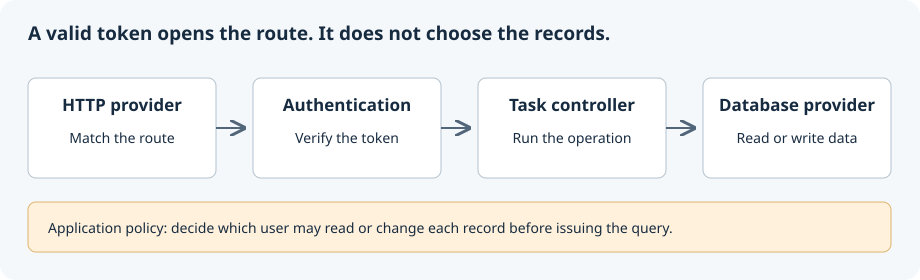

## Overview

Build the backend of a shared task board: tables, registration, login and generated CRUD routes. This is an API tutorial, not a frontend tutorial. The implementation below exposes these endpoints:

- `POST /api/auth/register` -- Create a new user account
- `POST /api/auth/login` -- Authenticate and receive a token
- `GET /api/auth/profile` -- Retrieve the authenticated user's profile
- `GET /api/tasks/list` -- List all tasks (authenticated)
- `GET /api/tasks/get?id=<id>` -- Get a single task (authenticated)
- `POST /api/tasks/new` -- Create a task (authenticated)
- `PUT /api/tasks/edit?id=<id>` -- Update a task (authenticated)
- `DELETE /api/tasks/delete?id=<id>` -- Delete a task (authenticated)

::warning
All authenticated users share the task collection. The `userId` relation records an association but does not enforce ownership; default routes do not call the custom `getTasksByUserId` method. Use disposable local data. Do not deploy this example as a private multi-user task manager without server-side authorization, input validation, unique-account enforcement and abuse controls.
::

## Follow the request

The API provider receives HTTP requests. Authentication validates the token; the task controller then calls the database contract through its model. MongoDB stores the records. Each provider is configured explicitly below.

{width="400"}

## Prerequisites

Use [Node.js 20.19 or later and the CLI](/docs/get-started/installation), pnpm, and a local MongoDB instance reachable at `mongodb://127.0.0.1:27017`. The example uses a disposable `antelope_tasks_tutorial` database and HTTP port `3000`.

Create an empty `my-app` directory. Add the `package.json` and `tsconfig.json` shown in the first step, then install these four interface packages in that directory. Keep the generated lockfile so subsequent installs use the same versions.

:::code-group

```bash [npm]
npm install @antelopejs/interface-api @antelopejs/interface-database-decorators @antelopejs/interface-auth @antelopejs/interface-data-api
```

```bash [yarn]
yarn add @antelopejs/interface-api @antelopejs/interface-database-decorators @antelopejs/interface-auth @antelopejs/interface-data-api
```

```bash [pnpm]
pnpm add @antelopejs/interface-api @antelopejs/interface-database-decorators @antelopejs/interface-auth @antelopejs/interface-data-api
```

:::

The interface dependencies provide types and APIs. The application configuration later adds the API, auth and database providers; those are separate from the module's interface dependencies.

## Application Structure

The completed project follows this layout:

```
my-app/
├── antelope.config.ts
├── src/
│   ├── index.ts
│   ├── db/
│   │   ├── tables/
│   │   │   ├── user.ts
│   │   │   └── task.ts
│   │   └── models/
│   │       ├── user-model.ts
│   │       └── task-model.ts
│   ├── routes/
│   │   └── auth.ts
│   └── data-api/
│       └── tasks.ts
└── package.json
```

The `db/` directory holds table definitions and data models. The `routes/` directory contains custom controllers for authentication. The `data-api/` directory uses the Data API to generate CRUD endpoints automatically.

## Building the Application

::steps{level="4"}

#### Set up the module

Create the module directory and initialize it with the required package configuration. The `antelopeJs` field in `package.json` tells the core how to load and resolve the module.

```json [package.json]
{
  "name": "my-app",
  "version": "1.0.0",
  "main": "dist/index.js",
  "scripts": {
    "build": "tsc"
  },
  "antelopeJs": {
    "implements": [],
    "baseUrl": "dist",
    "paths": {
      "@/*": ["*"]
    },
    "moduleAliases": {},
    "defaultConfig": {}
  },
  "dependencies": {
    "@antelopejs/interface-core": ">=0.2.3 <0.3.0"
  },
  "devDependencies": {
    "typescript": "^5.9.3",
    "@types/node": "^22.19.15"
  }
}
```

Set up TypeScript configuration with decorator support. This application does not publish a type API, so declaration generation is off; compile only `src`, not the project configuration at the root.

```json [tsconfig.json]
{
  "compilerOptions": {
    "target": "ES2020",
    "module": "commonjs",
    "outDir": "./dist",
    "rootDir": "./src",
    "declaration": false,
    "strict": true,
    "esModuleInterop": true,
    "experimentalDecorators": true,
    "emitDecoratorMetadata": true
  },
  "include": ["src/**/*.ts"]
}
```

#### Define the User table

The User table stores account credentials and profile information. The `@Hashed` modifier on the `password` property ensures passwords are hashed before storage. Extend `Table.with(HashModifier)` to enable hashing support.

```typescript [src/db/tables/user.ts]
import {
  Table,
  RegisterTable,
  Field,
  Index,
  Hashed,
} from "@antelopejs/interface-database-decorators";
import { HashModifier } from "@antelopejs/interface-database-decorators";

@RegisterTable("users", "main")
class User extends Table.with(HashModifier) {
  @Index()
  @Field("string")
  declare email: string;

  @Hashed()
  @Field("string")
  declare password: string;

  @Field("string")
  declare name: string;
}

export { User };
```

The `@Index` decorator on `email` enables fast lookups when authenticating users. The `@Hashed` decorator ensures the plaintext password is never stored in the database.

#### Define the Task table

The Task table stores task records associated with users. The `userId` field links each task to its owner: the `@Relation` decorator declares the link to the User table, and the `@Index` decorator enables efficient filtering by user.

```typescript [src/db/tables/task.ts]
import {
  Table,
  RegisterTable,
  Field,
  Index,
  Relation,
} from "@antelopejs/interface-database-decorators";
import { User } from "./user";

@RegisterTable("tasks", "main")
class Task extends Table {
  @Index()
  @Field("string")
  @Relation({ to: () => User })
  declare userId: string;

  @Field("string")
  declare title: string;

  @Field("string")
  declare description: string;

  @Field("boolean")
  declare completed: boolean;
}

export { Task };
```

#### Create the User model

The User model extends `BasicDataModel` with custom methods for authentication workflows. The `getUserByEmail` method retrieves a user by email address, and `createUser` handles user registration.

```typescript [src/db/models/user-model.ts]
import {
  BasicDataModel,
  GetModel,
} from "@antelopejs/interface-database-decorators";
import { User } from "../tables/user";

class UserModel extends BasicDataModel(User) {
  async getUserByEmail(email: string) {
    const users = await this.getBy("email", email);
    return users.length > 0 ? users[0] : null;
  }

  async createUser(data: { name: string; email: string; password: string }) {
    const existing = await this.getUserByEmail(data.email);
    if (existing) {
      throw new Error("A user with this email already exists");
    }
    return this.insert(data);
  }
}

export function getUserModel() {
  return GetModel(UserModel);
}

export { UserModel };
```

The `BasicDataModel` function provides `get`, `getBy`, `getAll`, `insert`, `update`, and `delete` methods automatically. Model instances require a database connection, so use `GetModel(YourModel)` to obtain a properly initialized instance. The custom methods add application-specific logic on top.

#### Create the Task model

The Task model demonstrates a query by `userId`. The generated endpoints below do **not** use this method: they expose the shared collection. A private task application must call scoped queries from custom handlers and check ownership for get, edit and delete as well.

```typescript [src/db/models/task-model.ts]
import {
  BasicDataModel,
  GetModel,
} from "@antelopejs/interface-database-decorators";
import { Task } from "../tables/task";

class TaskModel extends BasicDataModel(Task) {
  async getTasksByUserId(userId: string) {
    return this.getBy("userId", userId);
  }
}

export function getTaskModel() {
  return GetModel(TaskModel);
}

export { TaskModel };
```

#### Build the authentication routes

The auth controller handles user registration, login, and profile retrieval. Registration creates a new user, login validates credentials and returns a signed token, and the profile endpoint demonstrates the `@Authentication` decorator.

```typescript [src/routes/auth.ts]
import {
  Controller,
  Get,
  Post,
  JSONBody,
  HTTPResult,
} from "@antelopejs/interface-api";
import { SignRaw, Authentication } from "@antelopejs/interface-auth";
import { getUserModel } from "../db/models/user-model";

class AuthController extends Controller("/api/auth") {
  @Post("register")
  async register(
    @JSONBody() body: { name: string; email: string; password: string },
  ) {
    const userModel = getUserModel();
    try {
      const inserted = await userModel.createUser(body);
      const userId = inserted[0];
      const token = await SignRaw(
        { userId, email: body.email },
        { expiresIn: "24h" },
      );
      return {
        token,
        user: { id: userId, name: body.name, email: body.email },
      };
    } catch (error: any) {
      return new HTTPResult(400, { error: error.message });
    }
  }

  @Post("login")
  async login(@JSONBody() body: { email: string; password: string }) {
    const userModel = getUserModel();
    const user = await userModel.getUserByEmail(body.email);
    if (!user || !user.testHash("password", body.password)) {
      return new HTTPResult(401, { error: "Invalid credentials" });
    }

    const token = await SignRaw(
      { userId: user._id, email: user.email },
      { expiresIn: "24h" },
    );

    return { token };
  }

  @Get("profile")
  async profile(@Authentication() auth: any) {
    const userModel = getUserModel();
    const user = await userModel.get(auth.userId);
    if (!user) {
      return new HTTPResult(404, { error: "User not found" });
    }
    return { id: user._id, name: user.name, email: user.email };
  }
}
```

The `register` endpoint creates a user and returns a token so the client can start making authenticated requests. The `login` endpoint resolves the user by email, then verifies the plaintext password against the stored hash with `testHash`. The `profile` endpoint uses `@Authentication` to ensure only authenticated users can access it.

::tip
The `@Hashed` modifier on the User table handles password hashing transparently on insert: the original plaintext password never reaches the database. The `HashModifier` mixin also adds a `testHash(field, value)` method to the table class so you can compare a plaintext value against the stored hash during login.
::

#### Create the Task Data API

The Data API generates CRUD endpoints for the Task table with a single class definition. Decorating the class with `@Authentication()` registers an auth check as a computed property on the controller, so every generated route rejects unauthenticated requests before the handler runs.

```typescript [src/data-api/tasks.ts]
import {
  DataController,
  RegisterDataController,
  DefaultRoutes,
} from "@antelopejs/interface-data-api";
import { Controller } from "@antelopejs/interface-api";
import { Authentication } from "@antelopejs/interface-auth";
import { Model } from "@antelopejs/interface-database-decorators";
import {
  Access,
  AccessMode,
  Listable,
  Mandatory,
  ModelReference,
} from "@antelopejs/interface-data-api/metadata";
import { Task } from "../db/tables/task";
import { TaskModel } from "../db/models/task-model";

@RegisterDataController()
@Authentication()
class TaskDataController extends DataController(
  Task,
  DefaultRoutes.All,
  Controller("/api/tasks"),
) {
  @ModelReference()
  @Model(TaskModel)
  declare model: TaskModel;

  @Listable()
  @Access(AccessMode.ReadOnly)
  declare _id: string;

  @Listable()
  @Mandatory("new")
  @Access(AccessMode.ReadWrite)
  declare userId: string;

  @Listable()
  @Mandatory("new")
  @Access(AccessMode.ReadWrite)
  declare title: string;

  @Listable()
  @Mandatory("new")
  @Access(AccessMode.ReadWrite)
  declare description: string;

  @Listable()
  @Mandatory("new")
  @Access(AccessMode.ReadWrite)
  declare completed: boolean;
}
```

`@ModelReference()` identifies the model property, and `@Model(TaskModel)` supplies its instance. `@Access` selects readable/writable fields; `@Listable` includes them in list results. Table fields alone do not expose API fields. `@Mandatory("new")` requires values on creation without requiring every value on an edit.

#### Write the entry point

The module imports table and controller declarations, then initializes its schema in `construct()`. It consumes interfaces and does not implement any. The configured API provider, not this module's empty `start()`, opens the HTTP listener.

```typescript [src/index.ts]
import { RegisterSchema } from "@antelopejs/interface-database-decorators";

// Import tables to register them
import "./db/tables/user";
import "./db/tables/task";

// Import routes and data controllers to register them
import "./routes/auth";
import "./data-api/tasks";

export async function construct(): Promise<void> {
  // Register the database schema
  await RegisterSchema("main");
}

export function start(): void {
  // Application is ready
}

export async function stop(): Promise<void> {
  // Gracefully stop operations
}

export async function destroy(): Promise<void> {
  // Clean up resources
}
```

The import statements at the top ensure that all `@RegisterTable`, `Controller`, and `@RegisterDataController()` declarations execute and register their targets with the framework. The `RegisterSchema("main")` call initializes the database schema that both tables reference. This module consumes interfaces from other modules but does not export any of its own, so there is no `ImplementInterface` call.

#### Configure the project

The `antelope.config.ts` file defines the project structure and module configuration. It tells the AntelopeJS core where to find your module and any implementation modules for the interfaces you depend on.

```typescript [antelope.config.ts]
import { defineConfig } from "@antelopejs/interface-core/config";

export default defineConfig({
  name: "task-manager",
  modules: {
    "my-app": {
      source: {
        type: "local",
        path: "./",
        watchDir: "src",
        installCommand: "pnpm build",
        reloadCommand: "pnpm build",
      },
    },
    api: {
      source: { type: "package", package: "@antelopejs/api", version: "1.3.4" },
      config: {
        servers: [{ protocol: "http", host: "127.0.0.1", port: 3000 }],
        publicBaseUrl: "http://localhost:3000",
      },
    },
    auth: {
      source: { type: "package", package: "@antelopejs/auth-jwt", version: "1.0.3" },
      config: { secret: process.env.TASK_JWT_SECRET },
    },
    database: {
      source: { type: "package", package: "@antelopejs/mongodb", version: "1.4.2" },
      config: {
        url: "mongodb://127.0.0.1:27017",
        database: "antelope_tasks_tutorial",
      },
    },
  },
});
```

These provider versions make the example's choices explicit. Before upgrading, check their interface ranges and rerun the verification steps. For another database or HTTP stack, choose compatible providers and adapt their configuration.

#### Run the application

Build the module first to catch TypeScript errors separately from runtime setup. Then generate an ephemeral signing key for this terminal session and start the project (POSIX shell):

```bash
pnpm build
export TASK_JWT_SECRET="$(node -e 'process.stdout.write(require("node:crypto").randomBytes(32).toString("hex"))')"
ajs project dev
```

The core loads the module, initializes the database schema, registers all controllers, and starts the HTTP server. For automatic reloading during development, add the `--watch` flag:

```bash
ajs project dev --watch
```

::

## Verify the application

Use a fresh email address for each run, or clear only the disposable tutorial database. Register an account:

```bash
curl -sS http://127.0.0.1:3000/api/auth/register \
  -H 'Content-Type: application/json' \
  -d '{"name":"Ada","email":"ada@example.test","password":"local-demo-password"}'
```

The response contains `token` and `user.id`. In another terminal, set `TOKEN` and `USER_ID` to those returned values, then make the protected requests:

```bash
TOKEN='<token from registration>'
USER_ID='<user.id from registration>'

# Must reject: no authentication header
curl -i http://127.0.0.1:3000/api/tasks/list

# Must return the registered profile without its password hash
curl -sS http://127.0.0.1:3000/api/auth/profile \
  -H "x-antelopejs-auth: $TOKEN"

# Create a task; writable fields are the body itself
curl -sS http://127.0.0.1:3000/api/tasks/new \
  -H "x-antelopejs-auth: $TOKEN" -H 'Content-Type: application/json' \
  -d "{\"userId\":\"$USER_ID\",\"title\":\"Verify the API\",\"description\":\"Local tutorial\",\"completed\":false}"

curl -sS http://127.0.0.1:3000/api/tasks/list \
  -H "x-antelopejs-auth: $TOKEN"
```

The list response has `results`, `total`, `offset` and `limit`; find the inserted task in `results`. Also try a wrong password at `/api/auth/login`, an invalid token, and a second account. The second account can access the shared tasks: that is this example's access model, not an ownership guarantee.

| Failure | Check first |
| --- | --- |
| TypeScript cannot resolve an interface | Run the dependency installation in `my-app`, not its parent. |
| Database connection refused | Start MongoDB and check its URL before starting AntelopeJS. |
| Unresolved interface dependency | Confirm all three provider entries exist and their versions support the installed contracts. |
| Route returns 404 | Confirm the entry point imports the route/controller file and the local module rebuilt. |
| Token fails after restarting the shell | Use the same signing key or register/log in again with the new key. |

## Before production

This example omits runtime validation on the custom registration/login bodies, atomic email uniqueness, rate limiting, account recovery and token revocation. Add those policies before exposing it. For private tasks, derive the owner from verified authentication and enforce ownership on every operation; filtering the list alone is insufficient.

Use deployment-managed secrets, TLS, an appropriate public API origin and tests against two users' records. See [Authentication](/docs/guides/authentication) and [Data API](/docs/guides/data-api) for the boundary between authentication and authorization.

## API Summary

The completed application exposes the following endpoints:

| Method   | Endpoint                    | Auth | Description                               |
| -------- | --------------------------- | ---- | ----------------------------------------- |
| `POST`   | `/api/auth/register`        | No   | Create a new user account                 |
| `POST`   | `/api/auth/login`           | No   | Authenticate and receive a token          |
| `GET`    | `/api/auth/profile`         | Yes  | Retrieve the authenticated user's profile |
| `GET`    | `/api/tasks/list`           | Yes  | List all tasks                            |
| `GET`    | `/api/tasks/get?id=<id>`    | Yes  | Get a single task                         |
| `POST`   | `/api/tasks/new`            | Yes  | Create a new task                         |
| `PUT`    | `/api/tasks/edit?id=<id>`   | Yes  | Update an existing task                   |
| `DELETE` | `/api/tasks/delete?id=<id>` | Yes  | Delete a task                             |

Authenticated endpoints require a valid JWT token in the `x-antelopejs-auth` header:

```
x-antelopejs-auth: <token>
```
