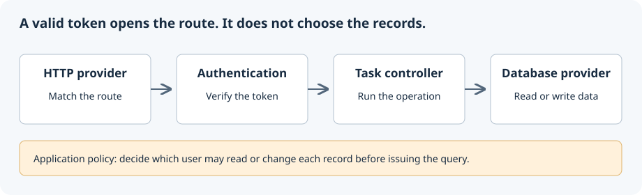

## Overview

In this tutorial, we build the backend of a shared task board: database tables, registration, login and generated CRUD routes. We build an API only, with no frontend. When we finish, the application exposes these endpoints:

- `POST /api/auth/register` creates a new user account.
- `POST /api/auth/login` checks the credentials and returns a token.
- `GET /api/auth/profile` returns the authenticated user's profile.
- `GET /api/tasks/list` lists all tasks. It requires authentication.
- `GET /api/tasks/get?id=<id>` returns one task. It requires authentication.
- `POST /api/tasks/new` creates a task. It requires authentication.
- `PUT /api/tasks/edit?id=<id>` updates a task. It requires authentication.
- `DELETE /api/tasks/delete?id=<id>` deletes a task. It requires authentication.

::warning
All authenticated users share the task collection. The `userId` relation records an association but does not enforce ownership. The default routes do not call the custom `getTasksByUserId` method. Use disposable local data. Do not deploy this example as a private multi-user task manager without server-side authorization, input validation, unique accounts and abuse controls.
::

## Follow the request

The API provider receives HTTP requests. Authentication checks the token, then the task controller calls the database contract through its model. MongoDB stores the records. We configure each provider by name in the last steps.

{width="400"}

## Prerequisites

Install Node.js and the `ajs` CLI as the [installation page](/docs/get-started/installation) describes. The Node.js versions the CLI supports are the `engines` field of `@antelopejs/core`'s `package.json`. To print it, run `npm view @antelopejs/core engines`. You also need pnpm and a local MongoDB instance at `mongodb://127.0.0.1:27017`. The example uses a disposable `antelope_tasks_tutorial` database and HTTP port `3000`.

First, create an empty `my-app` directory. Add the `package.json` and `tsconfig.json` from the first step. Then install these four interface packages in that directory. Keep the generated lockfile, so later installs use the same versions.

:::code-group

```bash [npm]
npm install @antelopejs/interface-api @antelopejs/interface-database-decorators @antelopejs/interface-auth @antelopejs/interface-data-api
```

```bash [yarn]
yarn add @antelopejs/interface-api @antelopejs/interface-database-decorators @antelopejs/interface-auth @antelopejs/interface-data-api
```

```bash [pnpm]
pnpm add @antelopejs/interface-api @antelopejs/interface-database-decorators @antelopejs/interface-auth @antelopejs/interface-data-api
```

:::

The interface packages provide types and APIs. The providers for the API, auth and database interfaces are separate modules. We add them to the project configuration in a later step.

## Application structure

The finished project has this layout:

```
my-app/
├── antelope.config.ts
├── src/
│   ├── index.ts
│   ├── db/
│   │   ├── tables/
│   │   │   ├── user.ts
│   │   │   └── task.ts
│   │   └── models/
│   │       ├── user-model.ts
│   │       └── task-model.ts
│   ├── routes/
│   │   └── auth.ts
│   └── data-api/
│       └── tasks.ts
└── package.json
```

The `db/` directory holds the table definitions and the data models. The `routes/` directory holds the custom authentication controller. The `data-api/` directory holds the controller that generates the CRUD endpoints with the Data API.

## Build the application

::steps{level="4"}

#### Set up the module

In `my-app`, create `package.json`. The `antelopeJs` field tells the core how to load and resolve the module.

```json [package.json]
{
  "name": "my-app",
  "version": "1.0.0",
  "main": "dist/index.js",
  "scripts": {
    "build": "tsc"
  },
  "antelopeJs": {
    "implements": [],
    "baseUrl": "dist",
    "paths": {
      "@/*": ["*"]
    },
    "moduleAliases": {},
    "defaultConfig": {}
  },
  "dependencies": {
    "@antelopejs/interface-core": ">=0.3.0 <1.0.0"
  },
  "devDependencies": {
    "typescript": "^5.9.3",
    "@types/node": "^22.19.15"
  }
}
```

Now create `tsconfig.json` with decorator support. The application publishes no type API, so declaration output is off. The compiler builds only `src`, not the project configuration at the root.

```json [tsconfig.json]
{
  "compilerOptions": {
    "target": "ES2020",
    "module": "commonjs",
    "outDir": "./dist",
    "rootDir": "./src",
    "declaration": false,
    "strict": true,
    "esModuleInterop": true,
    "experimentalDecorators": true,
    "emitDecoratorMetadata": true
  },
  "include": ["src/**/*.ts"]
}
```

#### Define the `User` table

The User table stores account credentials and profile information. The `@Hashed` modifier on the `password` property hashes the password before storage. Hashing needs the table to extend `Table.with(HashModifier)`.

```typescript [src/db/tables/user.ts]
import {
  Table,
  RegisterTable,
  Field,
  Index,
  Hashed,
} from "@antelopejs/interface-database-decorators";
import { HashModifier } from "@antelopejs/interface-database-decorators";

@RegisterTable("users", "main")
class User extends Table.with(HashModifier) {
  @Index()
  @Field("string")
  declare email: string;

  @Hashed()
  @Field("string")
  declare password: string;

  @Field("string")
  declare name: string;
}

export { User };
```

The `@Index` decorator on `email` indexes the field that login looks users up by. The `@Hashed` decorator keeps the plaintext password out of the database.

#### Define the `Task` table

The Task table stores task records linked to users. The `userId` field records that link, not an enforced owner. The `@Relation` decorator describes the link to the User table, and the `@Index` decorator supports queries by user.

```typescript fragment [src/db/tables/task.ts]
import {
  Table,
  RegisterTable,
  Field,
  Index,
  Relation,
} from "@antelopejs/interface-database-decorators";
import { User } from "./user";

@RegisterTable("tasks", "main")
class Task extends Table {
  @Index()
  @Field("string")
  @Relation({ to: () => User })
  declare userId: string;

  @Field("string")
  declare title: string;

  @Field("string")
  declare description: string;

  @Field("boolean")
  declare completed: boolean;
}

export { Task };
```

#### Create the `User` model

The User model extends `BasicDataModel` with two methods for authentication. `getUserByEmail` finds a user by email address, and `createUser` registers a new user.

```typescript fragment [src/db/models/user-model.ts]
import {
  BasicDataModel,
  GetModel,
} from "@antelopejs/interface-database-decorators";
import { User } from "../tables/user";

class UserModel extends BasicDataModel(User) {
  async getUserByEmail(email: string) {
    const users = await this.getBy("email", email);
    return users.length > 0 ? users[0] : null;
  }

  async createUser(data: { name: string; email: string; password: string }) {
    const existing = await this.getUserByEmail(data.email);
    if (existing) {
      throw new Error("A user with this email already exists");
    }
    return this.insert(data);
  }
}

export function getUserModel() {
  return GetModel(UserModel);
}

export { UserModel };
```

The `BasicDataModel` function provides the `get`, `getBy`, `getAll`, `insert`, `update` and `delete` methods. A model instance needs a database connection, so `GetModel(UserModel)` returns an initialized instance. The custom methods add the application's own logic.

#### Create the `Task` model

The Task model adds a query by `userId`. The generated endpoints below do **not** use this method. They expose the shared collection. A private task application must call scoped queries from custom handlers, and also check ownership for get, edit and delete.

```typescript fragment [src/db/models/task-model.ts]
import {
  BasicDataModel,
  GetModel,
} from "@antelopejs/interface-database-decorators";
import { Task } from "../tables/task";

class TaskModel extends BasicDataModel(Task) {
  async getTasksByUserId(userId: string) {
    return this.getBy("userId", userId);
  }
}

export function getTaskModel() {
  return GetModel(TaskModel);
}

export { TaskModel };
```

#### Build the authentication routes

The auth controller handles registration, login and the profile. Registration creates a new user. Login checks the credentials and returns a signed token. The profile endpoint uses the `@Authentication` decorator.

```typescript fragment [src/routes/auth.ts]
import {
  Controller,
  Get,
  Post,
  JSONBody,
  HTTPResult,
} from "@antelopejs/interface-api";
import { SignRaw, Authentication } from "@antelopejs/interface-auth";
import { getUserModel } from "../db/models/user-model";

class AuthController extends Controller("/api/auth") {
  @Post("register")
  async register(
    @JSONBody() body: { name: string; email: string; password: string },
  ) {
    const userModel = getUserModel();
    try {
      const inserted = await userModel.createUser(body);
      const userId = inserted[0];
      const token = await SignRaw(
        { userId, email: body.email },
        { expiresIn: "24h" },
      );
      return {
        token,
        user: { id: userId, name: body.name, email: body.email },
      };
    } catch (error: any) {
      return new HTTPResult(400, { error: error.message });
    }
  }

  @Post("login")
  async login(@JSONBody() body: { email: string; password: string }) {
    const userModel = getUserModel();
    const user = await userModel.getUserByEmail(body.email);
    if (!user || !user.testHash("password", body.password)) {
      return new HTTPResult(401, { error: "Invalid credentials" });
    }

    const token = await SignRaw(
      { userId: user._id, email: user.email },
      { expiresIn: "24h" },
    );

    return { token };
  }

  @Get("profile")
  async profile(@Authentication() auth: any) {
    const userModel = getUserModel();
    const user = await userModel.get(auth.userId);
    if (!user) {
      return new HTTPResult(404, { error: "User not found" });
    }
    return { id: user._id, name: user.name, email: user.email };
  }
}
```

The `register` endpoint creates a user and returns a token, so the client can send authenticated requests right away. The `login` endpoint finds the user by email, then checks the plaintext password against the stored hash with `testHash`. The `profile` endpoint uses `@Authentication`, so only authenticated users can call it.

::tip
The `@Hashed` modifier on the User table hashes the password on insert, so the plaintext password never reaches the database. The `HashModifier` mixin also adds a `testHash(field, value)` method to the table class. Login uses it to compare a plaintext value against the stored hash.
::

#### Create the task Data API

The Data API generates the CRUD endpoints for the Task table from one class. The `@Authentication()` decorator on the class registers an auth check as a computed property of the controller. Every generated route then rejects an unauthenticated request before the handler runs.

```typescript fragment [src/data-api/tasks.ts]
import {
  DataController,
  RegisterDataController,
  DefaultRoutes,
} from "@antelopejs/interface-data-api";
import { Controller } from "@antelopejs/interface-api";
import { Authentication } from "@antelopejs/interface-auth";
import { Model } from "@antelopejs/interface-database-decorators";
import {
  Access,
  AccessMode,
  Listable,
  Mandatory,
  ModelReference,
} from "@antelopejs/interface-data-api/metadata";
import { Task } from "../db/tables/task";
import { TaskModel } from "../db/models/task-model";

@RegisterDataController()
@Authentication()
class TaskDataController extends DataController(
  Task,
  DefaultRoutes.All,
  Controller("/api/tasks"),
) {
  @ModelReference()
  @Model(TaskModel)
  declare model: TaskModel;

  @Listable()
  @Access(AccessMode.ReadOnly)
  declare _id: string;

  @Listable()
  @Mandatory("new")
  @Access(AccessMode.ReadWrite)
  declare userId: string;

  @Listable()
  @Mandatory("new")
  @Access(AccessMode.ReadWrite)
  declare title: string;

  @Listable()
  @Mandatory("new")
  @Access(AccessMode.ReadWrite)
  declare description: string;

  @Listable()
  @Mandatory("new")
  @Access(AccessMode.ReadWrite)
  declare completed: boolean;
}
```

`@ModelReference()` marks the model property, and `@Model(TaskModel)` supplies its instance. `@Access` selects the fields a request can read or write, and `@Listable` adds them to list results. A table field alone does not expose an API field. `@Mandatory("new")` requires the value on create, but not on an edit.

#### Write the entry point

The entry point imports the table and controller files, then registers the schema in `construct()`. The module consumes interfaces and implements none. The configured API provider opens the HTTP listener, so the module's `start()` stays empty.

```typescript [src/index.ts]
import { RegisterSchema } from "@antelopejs/interface-database-decorators";

import "./db/tables/user";
import "./db/tables/task";
import "./routes/auth";
import "./data-api/tasks";

export async function construct(): Promise<void> {
  await RegisterSchema("main");
}

export function start(): void {}

export async function stop(): Promise<void> {}

export async function destroy(): Promise<void> {}
```

The imports at the top run every `@RegisterTable`, `Controller` and `@RegisterDataController()` declaration, which registers each target with the framework. The `RegisterSchema("main")` call registers the `main` schema that both tables use. The module exports no interface of its own, so it has no `ImplementInterface` call.

#### Configure the project

Create `antelope.config.ts` at the root of `my-app`. It lists the project's modules: our module, and one provider module for each interface it depends on.

```typescript [antelope.config.ts]
import { defineConfig } from "@antelopejs/interface-core/config";

export default defineConfig({
  name: "task-manager",
  modules: {
    "my-app": {
      source: {
        type: "local",
        path: "./",
        watchDir: "src",
        installCommand: "pnpm build",
        reloadCommand: "pnpm build",
      },
    },
    api: {
      source: { type: "package", package: "@antelopejs/api", version: "1.3.4" },
      config: {
        servers: [{ protocol: "http", host: "127.0.0.1", port: 3000 }],
        publicBaseUrl: "http://localhost:3000",
      },
    },
    auth: {
      source: { type: "package", package: "@antelopejs/auth-jwt", version: "1.0.3" },
      config: { secret: process.env.TASK_JWT_SECRET },
    },
    database: {
      source: { type: "package", package: "@antelopejs/mongodb", version: "1.4.2" },
      config: {
        url: "mongodb://127.0.0.1:27017",
        database: "antelope_tasks_tutorial",
      },
    },
  },
});
```

The config pins each provider to an exact version. Before you change a version, check the interface ranges it supports and run the verification steps again. For another database or HTTP stack, choose compatible providers and adapt their configuration.

#### Run the application

Build the module first, so TypeScript errors show up apart from runtime errors. Then generate a signing key for this terminal session and start the project. The commands below are for a POSIX shell.

```bash
pnpm build
export TASK_JWT_SECRET="$(node -e 'process.stdout.write(require("node:crypto").randomBytes(32).toString("hex"))')"
ajs project dev
```

`pnpm build` writes `dist/index.js`. `ajs project dev` installs the provider modules, loads our module, registers the schema and the controllers, and the API provider starts listening on port `3000`. To reload the module when its files change, add the `--watch` flag:

```bash
ajs project dev --watch
```

::

## Verify the application

Now we call the API. Use a new email address for each run, or clear only the disposable tutorial database. First, register an account:

```bash
curl -sS http://127.0.0.1:3000/api/auth/register \
  -H 'Content-Type: application/json' \
  -d '{"name":"Ada","email":"ada@example.test","password":"local-demo-password"}'
```

The response contains `token` and `user.id`. In another terminal, set `TOKEN` and `USER_ID` to those values. Then send the protected requests:

```bash
TOKEN='<token from registration>'
USER_ID='<user.id from registration>'

# Must reject: no authentication header
curl -i http://127.0.0.1:3000/api/tasks/list

# Must return the registered profile without its password hash
curl -sS http://127.0.0.1:3000/api/auth/profile \
  -H "x-antelopejs-auth: $TOKEN"

# Create a task; writable fields are the body itself
curl -sS http://127.0.0.1:3000/api/tasks/new \
  -H "x-antelopejs-auth: $TOKEN" -H 'Content-Type: application/json' \
  -d "{\"userId\":\"$USER_ID\",\"title\":\"Verify the API\",\"description\":\"Local tutorial\",\"completed\":false}"

curl -sS http://127.0.0.1:3000/api/tasks/list \
  -H "x-antelopejs-auth: $TOKEN"
```

The list response has `results`, `total`, `offset` and `limit`. Our new task is in `results`. Also try a wrong password at `/api/auth/login`, an invalid token, and a second account. The second account can read and change the shared tasks. That is the access model of this example, and it gives no ownership guarantee.

| Failure | Check first |
| --- | --- |
| TypeScript cannot resolve an interface | Run the dependency installation in `my-app`, not its parent. |
| Database connection refused | Start MongoDB and check its URL before you start AntelopeJS. |
| Unresolved interface dependency | Check that all three provider entries exist and that their versions support the installed contracts. |
| Route returns 404 | Check that the entry point imports the route or controller file, and that the module rebuilt. |
| Token fails after you restart the shell | Use the same signing key, or register or log in again with the new key. |

## Before production

This example leaves out runtime validation of the registration and login bodies, atomic email uniqueness, rate limiting, account recovery and token revocation. Add those policies before you expose it. For private tasks, take the owner from the verified authentication and enforce ownership on every operation. Filtering the list alone is not enough.

Use secrets that your deployment manages, TLS, the right public API origin, and tests against the records of two users. See [Authentication](/docs/guides/authentication) and [Data API](/docs/guides/data-api) for the boundary between authentication and authorization.

## API summary

The finished application exposes these endpoints:

| Method   | Endpoint                    | Auth | Description                               |
| -------- | --------------------------- | ---- | ----------------------------------------- |
| `POST`   | `/api/auth/register`        | No   | Create a new user account                 |
| `POST`   | `/api/auth/login`           | No   | Authenticate and receive a token          |
| `GET`    | `/api/auth/profile`         | Yes  | Retrieve the authenticated user's profile |
| `GET`    | `/api/tasks/list`           | Yes  | List all tasks                            |
| `GET`    | `/api/tasks/get?id=<id>`    | Yes  | Get a single task                         |
| `POST`   | `/api/tasks/new`            | Yes  | Create a new task                         |
| `PUT`    | `/api/tasks/edit?id=<id>`   | Yes  | Update an existing task                   |
| `DELETE` | `/api/tasks/delete?id=<id>` | Yes  | Delete a task                             |

Authenticated endpoints require a valid JWT in the `x-antelopejs-auth` header:

```
x-antelopejs-auth: <token>
```
