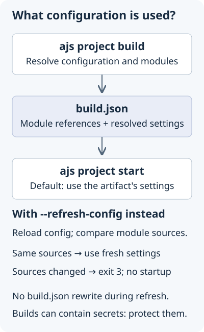

## Overview

The `ajs project` command group creates, runs, builds and starts a project, and manages its modules and its logging settings. [Project module commands](/docs/cli/project-modules) describes the `ajs project modules` commands.

Every command of the group accepts the [global options](/docs/cli/introduction#global-options): `--verbose`, `--quiet`, `--no-color` and `--help`. The commands that read a project also accept these two options:

- `-p, --project <path>` sets the project folder. It defaults to the current directory.
- `-e, --env <environment>` selects an entry of `environments` in `antelope.config.ts` instead of the base configuration.

When `antelope.config.ts` declares no `environments`, `--env` accepts any name and the command uses the base configuration. Otherwise, a name that the configuration does not declare is a usage error (exit code `2`). `ANTELOPEJS_PROJECT` and `ANTELOPEJS_LAUNCH_ENV` set the defaults of the two options.

## Project lifecycle

### `ajs project init`

Create a project folder with an `antelope.config.ts` file and its first module. The first module is either an existing module, imported from npm, git or a local path, or a new module created from a template of the interface repository.

```bash
ajs project init <project> [options]
```

| Argument  | Description                  |
| --------- | ---------------------------- |
| `project` | Directory of the new project |

| Option                         | Description                                                                            |
| ------------------------------ | -------------------------------------------------------------------------------------- |
| `--name <name>`                | Name of the project (default: the directory name)                                      |
| `-g, --git <url>`              | Interface repository URL, overriding the `git` CLI setting                             |
| `-t, --template <slug>`        | Template of the first module, by slug or exact name. Giving it skips the import question |
| `--interfaces <names>`         | Interfaces to add as dependencies of the first module (comma-separated)                |
| `--pm <npm\|yarn\|pnpm>`       | Package manager of the first module                                                    |
| `--git-init`, `--no-git-init`  | Initialize a git repository in the first module, or not                                |
| `-y, --yes`                    | Accept the default answer of every question no flag answers                            |

The command asks for the project name, then whether to import an existing module. An imported module comes from `package` (an npm package name), `git` (a repository URL) or `local` (a path). Otherwise, the command creates the first module from a template and asks the same questions as [`ajs module init`](/docs/cli/module#ajs-module-init): template, interfaces, package manager and git repository. `--template` takes the slug of a template, its name in lower case with each run of characters other than letters and digits replaced by `-` ("DMS Demo" is `dms-demo`). The exact name, quoted, still works, and an unknown template exits with code `2` and lists the slugs. The command asks every question before it writes anything. Cancelling with `Ctrl+C` writes nothing and exits with code `130`.

A flag answers each question, so the command runs in scripts and CI. When standard input is not a terminal, or `CI` is set, the command never prompts. It names the project after its directory unless you pass `--name`, and it creates the first module from a template. The interface repository comes from `--git`, else `ANTELOPEJS_GIT`, else the `git` CLI setting, exactly as for [`ajs module init`](/docs/cli/module#ajs-module-init). The command checks the project path and the interface repository first, so it reports an existing project or an unreachable repository as such. Then, if a question has no flag to answer it, the command exits with code `2` before it writes anything, and the error lists the flags to pass. `--yes` answers the remaining questions with their defaults: the directory name, the first template, no interface, `npm`, and a git repository.

A complete project template can require a package manager and give its own next steps. It already selects its dependencies, so the command skips the interface question unless you pass `--interfaces`. A required package manager replaces the `npm` default. A `--pm` that does not match it fails before the command creates any file.

A template whose manifest entry sets `"install": false` installs its own dependencies, for example inside its container, so the host does not need its package manager. For such a template the command copies the files and prints `Skipped the dependency install`. It asks no package manager question, ignores `--pm`, and does not write `packageManager` to `package.json`. The git repository, if requested, is still created.

When a template contains `antelope.config.ts`, the CLI keeps that file as it is. It does not evaluate or rewrite the file, and it does not add a duplicate root module. The template's project name stays too, because `--name` only names a configuration that the CLI generates. To rename a complete project, edit the copied configuration.

When copying the template or installing its dependencies fails, the command removes the project directory it created, so the same command can run again. A directory that existed before is left as it was found. Every template copy leaves out the template repository's own `.git`, `.agents` and `.claude/skills` entries, which hold its version control and its verification tooling, as folders or links. The rest of `.claude/`, such as `settings.json`, stays. Files that the target directory already holds at `.agents` or `.claude/skills` stay in place.

**Examples:**

```bash
# Answer the questions interactively
ajs project init my-app

# Accept every default
ajs project init my-app --yes

# Answer every question with a flag, for scripts and CI
ajs project init my-app --template blank-typescript --pm pnpm --no-git-init

# Read the templates from another interface repository (a URL or a local path)
ajs project init my-app --git https://github.com/your-org/interfaces.git

# Create the complete DMS demo (see its README for the prerequisites)
ajs project init my-dashboard --template dms-demo --yes
```

For the DMS demo, the CLI installs both workspace packages with pnpm. Development needs no setup script and no `.env` file. Start MongoDB, then run `pnpm dev` in the created project directory, and `pnpm frontend:dev` in a second terminal. The [template README](https://github.com/AntelopeJS/template-dms-demo#getting-started) lists the prerequisites and the optional environment overrides.

For a module template, the command ends with a summary and the commands that usually come next:

```text
Created project my-app → ./my-app

Next steps
  cd ./my-app
  npx @antelopejs/core project modules install  add modules for the interfaces no module implements
  npx @antelopejs/core project dev --watch      run the project and reload it on changes
```

The printed commands use `npx @antelopejs/core`, so they run without a global `ajs`. Inside the project, `npx` uses the `@antelopejs/core` the template installed.

---

### `ajs project dev`

Run the project in development mode. The command downloads and installs its modules, then loads and connects them.

```bash
ajs project dev [options]
```

| Option                       | Description                                                     |
| ---------------------------- | --------------------------------------------------------------- |
| `-p, --project <path>`       | Path of the project folder (default: current directory)         |
| `-e, --env <environment>`    | Environment of `antelope.config.ts` to use                      |
| `-w, --watch`                | Reload modules when their source files change (HMR)             |
| `-c, --concurrency <number>` | Number of modules to load concurrently                          |
| `--inspect [host:port]`      | Enable the Node.js inspector (default: `127.0.0.1:9229`)        |
| `-i, --interactive`          | Open a REPL with the project loaded                             |

To see TRACE logs, add the global `--verbose` option, for example `ajs project dev --verbose=loader`.

Press `Ctrl+C` to stop the project at any time, even while its modules are still loading or starting. A launch in progress stops where it is. The module version check stops waiting for the npm registry, and `ajs` leaves alone the modules it has not loaded, constructed or started yet. `ajs` then stops and destroys the modules and terminates the processes they started and left running, such as a sidecar or a dev server. It prints `Stopped the project` and exits with code `130`. `SIGTERM` stops the project the same way and exits with code `0`.

The modules get 10 seconds to stop. After that, the shutdown reports that it timed out, terminates the leftover processes, and exits. To exit at once without waiting for the modules, press `Ctrl+C` again. `ajs` still kills the leftover processes.

**Examples:**

```bash
# Run the project and reload it on changes
ajs project dev --watch

# Run another project with its staging environment
ajs project dev -p ./my-app -e staging

# Enable the Node.js inspector
ajs project dev --inspect 127.0.0.1:9229

# Open a REPL with the project loaded
ajs project dev -i
```

::tip
During development, run `ajs project dev --watch` to reload modules when their source files change.
::

---

### `ajs project run`

`ajs project run` is the former name of `ajs project dev`, kept for compatibility. It accepts the same options and behaves the same way. Use `ajs project dev` in new scripts.

```bash
ajs project run [options]
```

---

### `ajs project build`

Build the project for production. The command downloads and installs its modules, and checks that every module loads and that every imported interface is implemented. It also checks that the shared copy of each interface package satisfies the range that every module declares for it. Then it writes the build artifact `.antelope/build/build.json`.

```bash
ajs project build [options]
```

| Option                    | Description                                             |
| ------------------------- | ------------------------------------------------------- |
| `-p, --project <path>`    | Path of the project folder (default: current directory) |
| `-e, --env <environment>` | Environment of `antelope.config.ts` to build            |
| `--frozen-modules`        | Install every npm module from its lock in `antelope-lock/`, and fail when a module has none. Setting `ANTELOPEJS_FROZEN_MODULES` to `1` or `true` does the same |

**Example:**

```bash
ajs project build -e production
```

```text
✔ Installed dependencies for my-module
✔ Loaded 1 module
Built 1 module → ./.antelope/build/build.json · 824ms

Next steps
  ajs project start  start the project from this build
```

`build.json` holds the module manifests and a configuration hash. `ajs project start` reads this file to launch the application without resolving the modules again.

When a module declares a range of an interface package that excludes the shared copy, the build fails with the `Incompatible interface package resolution` error that `ajs project start` would otherwise print. The build then writes no `build.json` and leaves a previous one as it was. The error names the module, its range, the shared version, and the module that the shared copy comes from, and then lists the fixes. Its first line reads like this:

```text
backend requires @antelopejs/interface-auth@>=0.0.7 <0.1.0, but the shared copy is 0.1.0 (provided by auth-jwt)
```

[Incompatible interface package resolution](/docs/guides/troubleshooting#incompatible-interface-package-resolution) describes the fixes.

The check follows the order in which `ajs project start` loads modules. It checks the modules that are not marked `optional: true` together. It then checks each `optional: true` module on its own. It skips a module that would fail and prints a warning, because `start` runs without that module. Only a conflict among the required modules fails the build.

The build records the module locks of the npm modules it installs. [Module locks](/docs/cli/project-modules#module-locks) describes them and `--frozen-modules`.

---

### `ajs project start`

Start the project from the build artifact `.antelope/build/build.json`. The command skips module download and resolution, so the project starts faster and the same way every time.

```bash
ajs project start [options]
```

| Option                       | Description                                                                              |
| ---------------------------- | ---------------------------------------------------------------------------------------- |
| `-p, --project <path>`       | Path of the project folder (default: current directory)                                  |
| `-e, --env <environment>`    | Environment of `antelope.config.ts` to use                                               |
| `-c, --concurrency <number>` | Number of modules to load concurrently                                                   |
| `--refresh-config`           | Resolve `antelope.config.ts` for the environment instead of using the build configuration |

**Example:**

```bash
ajs project start -e production
```

`ajs project start` goes straight to the production runtime. It does not load the developer CLI or the scaffolding commands, and it does not check the npm registry for a CLI update. Use it in production containers and process managers, after `ajs project build`.

`SIGTERM` and `Ctrl+C` stop the project the way they stop [`ajs project dev`](#ajs-project-dev). The exit code is `0` after `SIGTERM` and `130` after `Ctrl+C`.

#### Build once, start with the runtime configuration

By default, `ajs project start` runs every module with the configuration that `ajs project build` resolved and stored in `build.json`. A container image built that way carries the configuration of the build environment, secrets included.

{width="400"}

To build the image once, without secrets, and start it with the configuration of the environment it runs in, pass `--refresh-config`:

```bash
# Image build: download, install and validate modules
ajs project build -e production

# Container start: resolve antelope.config.ts against this environment
ajs project start -e production --refresh-config
```

At start, the command resolves `antelope.config.ts` for the `--env` environment the same way `ajs project build` does. That includes `environments` entries, `antelope.<module>.json` files, and `envOverrides` read from the process environment. When the configuration loads the same modules from the same sources as the build, each module starts with its refreshed `config`, `importOverrides` and `disabledExports`, and the project uses the refreshed `logging` settings. Module files, manifests and the cache folder stay those of the build.

The refreshed artifact lives only in memory, and the command does not rewrite `build.json`. Your configuration code, modules or logging can still write secrets elsewhere.

Two module sets match when they declare the same module ids with the same `source`. The command resolves relative local paths against the project folder before it compares them. When the sets differ, the command starts nothing and exits with code `3`. Rebuild in your build environment and deploy the matching artifact. Do not build automatically inside a production process that holds secrets, because the new artifact would store those resolved secrets.

```bash
status=0
ajs project start -e production --refresh-config || status=$?
if [ "$status" -eq 3 ]; then
  echo 'Module sources changed. Rebuild and redeploy the artifact.' >&2
fi
exit "$status"
```

Invalid arguments exit with code `2`, and any other failure exits with code `1`. The command cannot trace a module loaded from a `local-folder` source back to its source in the build, so a project that uses one always needs a full build.

Programmatic callers pass `{ refreshConfig: true }` to `launchFromBuild()`, which rejects with a `BuildModuleSetChangedError` when the module set differs.

---

### Development-to-production workflow

The lifecycle commands run in this order, from development to deployment:

1. `ajs project dev` runs the project and resolves its modules on each launch. Add `--watch` to reload modules while you work on them.
2. `ajs project build` writes the build artifact `build.json`, which fixes the module versions and the configuration. Commit `antelope-lock/`, and build with `--frozen-modules` in CI.
3. `ajs project start` launches the project from the build artifact in production. It skips resolution, so every start is the same.

```bash
# Development
ajs project dev --watch

# Build for production
ajs project build -e production

# Start in production
ajs project start -e production
```

## Logging configuration

These subcommands show and change the `logging` block of `antelope.config.ts`. The runtime applies these settings when the project runs with `ajs project dev`, `build` or `start`. They turn logging on or off and set module tracking and its filters, the date format, and the template of each level.

### `ajs project logging show`

Show the current logging settings. The alias is `ls`.

```bash
ajs project logging show [options]
ajs project logging ls [options]
```

| Option                    | Description                                             |
| ------------------------- | ------------------------------------------------------- |
| `-p, --project <path>`    | Path of the project folder (default: current directory) |
| `-e, --env <environment>` | Environment of `antelope.config.ts` to show             |
| `-j, --json`              | Print the result as JSON on stdout                      |

The command prints a summary of the settings as key/value lines. Only `--json` prints the level templates. It prints the full logging configuration merged with the defaults.

**Example:**

```bash
ajs project logging show
```

```text
ℹ Logging configuration of acme-shop (default)
Enabled          yes
Module tracking  only billing
Date format      yyyy-MM-dd HH:mm:ss
Level formats    custom for INFO, see --json for the templates
```

---

### `ajs project logging set`

Change the logging settings of the project. The options turn logging on or off, control module tracking, filter which modules log, and set the log format.

```bash
ajs project logging set [options]
```

| Option                       | Description                                                       |
| ---------------------------- | ----------------------------------------------------------------- |
| `--enable`                   | Enable logging                                                    |
| `--disable`                  | Disable logging                                                   |
| `--enable-module-tracking`   | Enable module tracking (prefixes log lines with their module)     |
| `--disable-module-tracking`  | Disable module tracking                                           |
| `--include-module <module>`  | Add a module to the include list                                  |
| `--exclude-module <module>`  | Add a module to the exclude list                                  |
| `--remove-include <module>`  | Remove a module from the include list                             |
| `--remove-exclude <module>`  | Remove a module from the exclude list                             |
| `--level <level>`            | Level whose template `--format` replaces (requires `--format`)    |
| `--format <format>`          | Template for the level selected by `--level` (requires `--level`) |
| `--date-format <format>`     | Format of `{{DATE}}`, with tokens such as `yyyy`, `MM`, `dd`, `HH`, `mm`, `ss` and `SSS` |
| `-i, --interactive`          | Ask for each setting                                              |
| `-p, --project <path>`       | Path of the project folder (default: current directory)           |
| `-e, --env <environment>`    | Environment of `antelope.config.ts` to change                     |

The camelCase spellings of earlier versions still work until the next minor version: `--enableModuleTracking`, `--disableModuleTracking`, `--includeModule`, `--excludeModule`, `--removeInclude`, `--removeExclude` and `--dateFormat`. The help does not show them, and each prints a deprecation warning that names the new spelling.

The include and exclude lists filter log lines by module, so they apply only while module tracking is on. With a non-empty include list, only the listed modules log.

**Examples:**

```bash
# Enable logging
ajs project logging set --enable

# Only show the logs of one module
ajs project logging set --enable-module-tracking --include-module @antelopejs/api

# Use a custom template for DEBUG lines
ajs project logging set --level debug --format "[{{DATE}}] {{ARGS}}"

# Customize the INFO lines, with styles
ajs project logging set --level info --format "{{chalk.gray}}[{{DATE}}]{{chalk.reset}} {{ARGS}}"

# Answer the questions interactively
ajs project logging set -i
```

```text
✔ Module tracking enabled
✔ Added @antelopejs/api to the include list
Saved the logging configuration of my-app

Next steps
  ajs project logging show  view the current settings
```

The command writes only the settings that change to `antelope.config.ts`, in the `logging` block of the selected environment. When every setting is already in place, the command says so and leaves the file untouched. Without any setting, or with `--interactive`, the command asks its questions. When standard input is not a terminal, or `CI` is set, it exits with code `2` instead and names the setting flags to pass. Cancelling the questions with `Ctrl+C` writes nothing and exits with code `130`.

`--level` selects the level whose template `--format` sets. The levels are `trace`, `debug`, `info`, `warn` and `error`, and `default` covers the levels without a template of their own. The two flags go together, and one without the other exits with code `2`. `--level` does not set a minimum log level. To show `DEBUG` and `TRACE` lines, run `ajs project dev`, `build` or `start` with `--verbose`.

The runtime renders every log line of a level with its saved template, which replaces the whole line. The runtime does not add the module prefix and the right-aligned date of the built-in format, so use `{{MODULE}}` and `{{DATE}}` instead. Levels without a saved template keep the built-in format. The template accepts these placeholders:

| Placeholder         | Description                                                                                                       |
| ------------------- | ----------------------------------------------------------------------------------------------------------------- |
| `{{DATE}}`          | Timestamp in the `--date-format` format                                                                           |
| `{{ARGS}}`          | The log message                                                                                                   |
| `{{CHANNEL}}`       | Channel name                                                                                                      |
| `{{MODULE}}`        | ID of the module that logged the line (when module tracking is on)                                                |
| `{{LEVEL_NAME}}`    | Level name (`TRACE`, `DEBUG`, `INFO`, `WARN`, `ERROR`, or `LOG` for other levels)                                 |
| `{{chalk.<color>}}` | Inline style, such as `{{chalk.red}}` or `{{chalk.bold}}`. Removed when colors are off (no terminal, `NO_COLOR`) |

::tip
To set several logging options at once with guided questions, run `ajs project logging set -i`.
::
